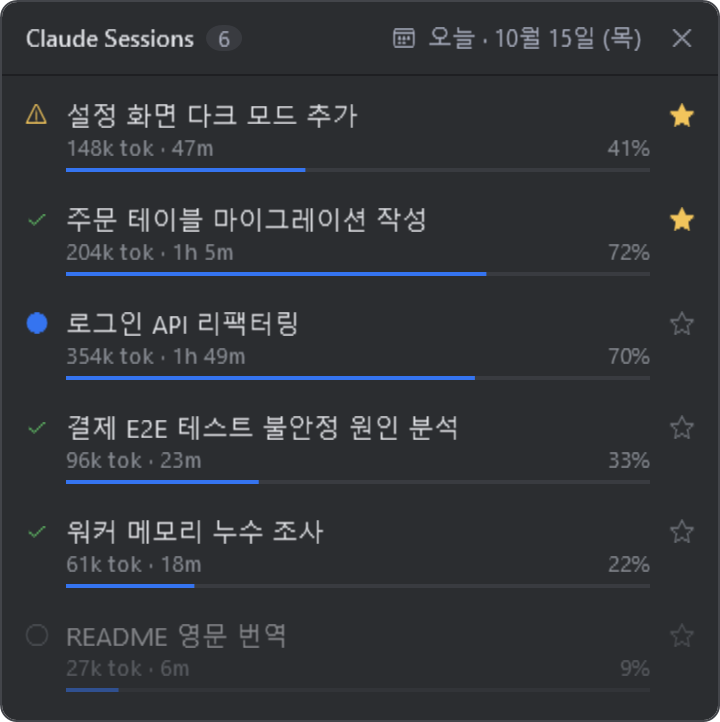

# Claude Sessions

[English](README.md) | 한국어

Claude Code 세션들을 한눈에 보는 Windows·macOS 데스크톱 위젯입니다.
화면 우측 하단에 항상 위로 떠서, 어느 세션이 일하는 중이고 어느 세션이 끝났는지 알려 줍니다.



## 기능

- 선택한 날짜에 사용한 세션 목록: 제목, 사용 토큰, 진행 시간, 컨텍스트 사용률
- 상태 표시: 작업 중 / 완료(입력 대기) / 권한 승인 대기 / 종료
- ★ 중요 세션을 목록 맨 위에 고정
- 달력으로 지난 날짜 조회
- 세션을 클릭하면 VS Code의 해당 Claude Code 세션으로 이동
- 파일 하나, 설치할 패키지 없음. 시스템 언어에 따라 한국어/영어 화면

## 요구 사항

- [Claude Code](https://claude.com/claude-code) (CLI 또는 VS Code 확장)
- Windows 10 / 11: 추가 설치 없음 (Windows PowerShell 5.1 기본 내장). 클릭해서 세션 열기는 VS Code `code` 명령이 PATH에 있어야 합니다
- macOS 13 이상: Xcode 명령줄 도구 (`xcode-select --install`)

## Windows

### 설치

PowerShell에서:

```powershell
irm https://github.com/yeonizin/claude-session-board/releases/latest/download/session-board.ps1 -OutFile "$HOME\.claude\session-board.ps1"
```

또는 [최신 릴리스](https://github.com/yeonizin/claude-session-board/releases/latest)에서 `session-board.ps1`을 내려받아 원하는 곳에 두면 됩니다.

### 실행

```powershell
powershell -ExecutionPolicy Bypass -WindowStyle Hidden -File "$HOME\.claude\session-board.ps1"
```

Windows 시작 시 자동으로 띄우려면 `Win + R` → `shell:startup` 폴더에 위 명령으로 바로가기를 만들면 됩니다.

## macOS

```sh
curl -fsSL https://github.com/yeonizin/claude-session-board/releases/latest/download/session-board.swift -o ~/.claude/session-board.swift
nohup swift ~/.claude/session-board.swift >/dev/null 2>&1 &
```

처음 실행할 때 Swift가 스크립트를 컴파일하느라 몇 초 걸립니다.

## 화면 읽는 법

| 표시 | 의미 |
|---|---|
| 🔵 | Claude가 작업 중 |
| ✓ | 응답을 끝내고 입력을 기다리는 중 |
| ⚠ | 도구 사용 권한 승인을 기다리는 중 |
| ○ (흐리게) | 세션 창이 닫힘 |
| `312k tok` | 세션에서 사용한 토큰 누적 (캐시 재사용분 제외) |
| `1h 42m` | 첫 메시지부터 마지막 활동까지 걸린 시간 |
| 막대와 `%` | 컨텍스트 사용률. 100%에 가까워지면 Claude Code가 이전 대화를 자동 압축합니다 |

### 토큰이 더 많은데 막대는 더 낮은 이유

두 값은 서로 다른 것을 잽니다.

| 표시 | 재는 것 | 줄어드는가 |
|---|---|---|
| `tok` | 세션 시작부터 지금까지 처리한 양의 누적 | 줄지 않음 |
| 막대 | 마지막 응답 때 Claude가 한 번에 보고 있던 대화 크기 ÷ 컨텍스트 창 크기 | 압축되면 줄어듦 |

그래서 오래 쓴 세션이 `tok`는 더 많아도 막대는 더 낮을 수 있습니다.

- **자동 압축이 일어났다**: 이전 대화가 요약되면 막대는 떨어지지만 `tok`는 그대로입니다.
- **컨텍스트 창이 더 크다**: 200k 토큰을 넘긴 적이 있는 세션은 1M 창 기준으로 계산합니다. 같은 양이어도 막대가 1/5 길이로 보입니다.

막대가 높을수록 메시지를 보낼 때마다 Claude가 다시 읽는 양도 많아집니다. 다시 읽는 부분은 대부분 캐시를 재사용하므로 `tok`에는 잡히지 않고, 요금도 할인됩니다.
주제가 바뀌면 `/clear`로 비우고, 같은 작업을 이어갈 때는 `/compact`로 직접 압축하면 됩니다.

## 동작 원리

Claude Code가 로컬에 남기는 파일만 읽습니다. **네트워크 통신은 하지 않습니다.**

| 읽는 파일 | 용도 |
|---|---|
| `~/.claude/projects/*/*.jsonl` | 세션 제목, 토큰 사용량, 시간, 작업 폴더 |
| `~/.claude/sessions/*.json` | 실행 중인 세션과 상태 |

쓰는 파일은 별표 목록을 저장하는 `~/.claude/session-board.json` 하나뿐입니다.
`CLAUDE_CONFIG_DIR` 환경 변수가 있으면 `~/.claude` 대신 그 경로를 씁니다.

각 OS 버전 모두 읽기 쉬운 스크립트 파일 하나입니다. 실행 전에 한 번 훑어보시길 권합니다.

## 한계

- Claude Code **내부 파일 형식**에 의존합니다. Claude Code가 업데이트되면 동작하지 않을 수 있습니다.
- Claude Code는 기본적으로 30일이 지난 대화 기록을 삭제하므로, 그보다 이전 날짜는 비어 있습니다. 보관 기간은 Claude Code 설정의 `cleanupPeriodDays`로 늘릴 수 있습니다.
- 토큰과 진행 시간은 선택한 날짜 하루치가 아니라 세션 전체 합계입니다.
- 컨텍스트 창 크기는 대화 기록에 남지 않아서, 200k 토큰을 넘긴 적이 있는 세션은 1M 창으로 간주합니다.

이 프로젝트는 Anthropic과 관련 없는 개인 프로젝트입니다.

## 라이선스

[MIT](LICENSE)
