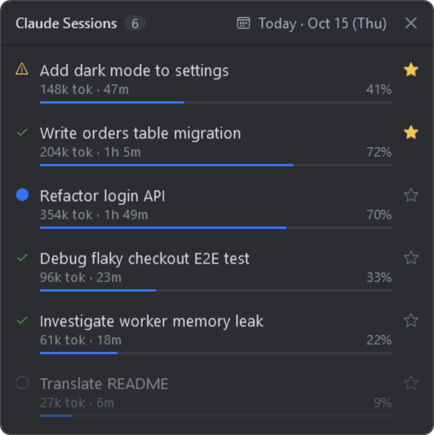

# Claude Sessions

Claude Code 세션들을 한눈에 보는 Windows 데스크톱 위젯입니다.
화면 우측 하단에 항상 위로 떠서, 어느 세션이 일하는 중이고 어느 세션이 끝났는지 알려 줍니다.



## 기능

- 선택한 날짜에 사용한 세션 목록: 제목, 사용 토큰, 진행 시간, 컨텍스트 사용률
- 상태 표시: 작업 중 / 완료(입력 대기) / 권한 승인 대기 / 종료
- ★ 중요 세션을 목록 맨 위에 고정
- 달력으로 지난 날짜 조회
- 세션을 클릭하면 VS Code의 해당 Claude Code 세션으로 이동
- 파일 하나, 설치할 패키지 없음

## 요구 사항

- Windows 10 / 11 (Windows PowerShell 5.1, 기본 내장)
- [Claude Code](https://claude.com/claude-code) (CLI 또는 VS Code 확장)
- 클릭해서 세션 열기: VS Code와 `code` 명령이 PATH에 있어야 합니다

## 설치

PowerShell에서:

```powershell
irm https://raw.githubusercontent.com/yeonizin/claude-session-board/main/session-board.ps1 -OutFile "$HOME\.claude\session-board.ps1"
```

## 실행

```powershell
powershell -ExecutionPolicy Bypass -WindowStyle Hidden -File "$HOME\.claude\session-board.ps1"
```

Windows 시작 시 자동으로 띄우려면 `Win + R` → `shell:startup` 폴더에 위 명령으로 바로가기를 만들면 됩니다.

## 화면 읽는 법

| 표시 | 의미 |
|---|---|
| 🔵 | Claude가 작업 중 |
| ✓ | 응답을 끝내고 입력을 기다리는 중 |
| ⚠ | 도구 사용 권한 승인을 기다리는 중 |
| ○ (흐리게) | 세션 창이 닫힘 |
| `312k tok` | 세션에서 사용한 토큰 누적 (캐시 재사용분 제외) |
| `1h 42m` | 첫 메시지부터 마지막 활동까지 걸린 시간 |
| 막대와 `%` | 컨텍스트 사용률. 100%에 가까워지면 Claude Code가 이전 대화를 자동 압축합니다 |

## 동작 원리

Claude Code가 로컬에 남기는 파일만 읽습니다. **네트워크 통신은 하지 않습니다.**

| 읽는 파일 | 용도 |
|---|---|
| `~/.claude/projects/*/*.jsonl` | 세션 제목, 토큰 사용량, 시간, 작업 폴더 |
| `~/.claude/sessions/*.json` | 실행 중인 세션과 상태 |

쓰는 파일은 별표 목록을 저장하는 `~/.claude/session-board.json` 하나뿐입니다.
`CLAUDE_CONFIG_DIR` 환경 변수가 있으면 `~/.claude` 대신 그 경로를 씁니다.

## 한계

- Claude Code **내부 파일 형식**에 의존합니다. Claude Code가 업데이트되면 동작하지 않을 수 있습니다.
- Claude Code는 기본적으로 30일이 지난 대화 기록을 삭제하므로, 그보다 이전 날짜는 비어 있습니다. 보관 기간은 Claude Code 설정의 `cleanupPeriodDays`로 늘릴 수 있습니다.
- 토큰과 진행 시간은 선택한 날짜 하루치가 아니라 세션 전체 합계입니다.
- 컨텍스트 창 크기는 대화 기록에 남지 않아서, 200k 토큰을 넘긴 적이 있는 세션은 1M 창으로 간주합니다.
- Windows 전용입니다.

이 프로젝트는 Anthropic과 관련 없는 개인 프로젝트입니다.

## 라이선스

[MIT](LICENSE)
