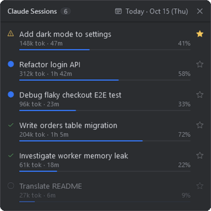

# Claude Sessions

English | [한국어](README.ko.md)

A small always-on-top Windows widget that shows all your Claude Code sessions at a glance: which ones are working, which ones are done and waiting for you, and how full each context window is.



## Features

- Sessions for any day: title, tokens used, elapsed time, context usage bar
- Status: working / done (waiting for input) / waiting for permission / closed
- Pin important sessions to the top
- Calendar to browse previous days
- Click a session to jump to it in VS Code
- Single file, nothing to install. English or Korean UI, following your Windows display language

## Requirements

- Windows 10 / 11 (uses the built-in Windows PowerShell 5.1)
- [Claude Code](https://claude.com/claude-code) (CLI or VS Code extension)
- To jump to a session: VS Code with the `code` command on your PATH

## Install

In PowerShell:

```powershell
irm https://github.com/yeonizin/claude-session-board/releases/latest/download/session-board.ps1 -OutFile "$HOME\.claude\session-board.ps1"
```

Or download `session-board.ps1` from the [latest release](https://github.com/yeonizin/claude-session-board/releases/latest) and put it anywhere.

## Run

```powershell
powershell -ExecutionPolicy Bypass -WindowStyle Hidden -File "$HOME\.claude\session-board.ps1"
```

To start it with Windows, press `Win + R`, open `shell:startup`, and create a shortcut with the command above.

## Reading the widget

| Mark | Meaning |
|---|---|
| Blue dot | Claude is working |
| Check | Claude finished and is waiting for your input |
| Warning | Claude is waiting for a tool permission |
| Faded circle | The session window is closed |
| `312k tok` | Tokens used by the session (cache reads excluded) |
| `1h 42m` | Time from the first message to the latest activity |
| Bar and `%` | Context window usage. Near 100%, Claude Code compacts the conversation |

## How it works

It only reads files Claude Code already keeps on your machine. **It makes no network requests.**

| File | Used for |
|---|---|
| `~/.claude/projects/*/*.jsonl` | Session title, token usage, timing, working folder |
| `~/.claude/sessions/*.json` | Which sessions are running and their status |

The only file it writes is `~/.claude/session-board.json`, which stores your pinned sessions.
If `CLAUDE_CONFIG_DIR` is set, that folder is used instead of `~/.claude`.

The whole widget is one readable PowerShell script. Please look through it before running it.

## Limitations

- It relies on Claude Code's **internal file formats**, which may change in a Claude Code update.
- Claude Code deletes transcripts older than 30 days by default, so older days show nothing. You can raise `cleanupPeriodDays` in your Claude Code settings.
- Tokens and time are totals for the whole session, not just the selected day.
- The context window size is not recorded in transcripts, so any session that has gone over 200k tokens is treated as a 1M window.
- Windows only.

This is a personal project and is not affiliated with Anthropic.

## License

[MIT](LICENSE)
